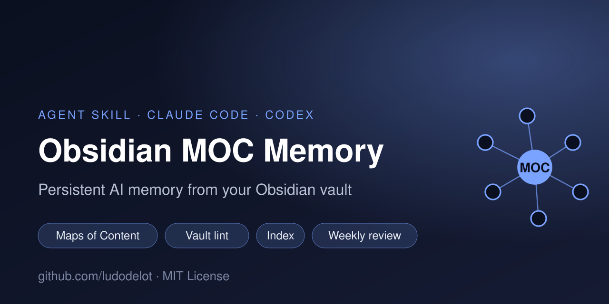
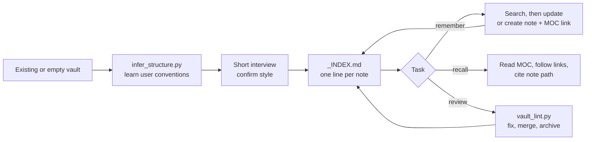

<div align="center">



# Obsidian MOC Memory

**Give Claude Code, Codex and Cursor a persistent second brain: an Obsidian vault organised with Maps of Content (MOCs).**

[](LICENSE)
[](SKILL.md)
[](scripts)
[](https://obsidian.md)
[](scripts)
[](#privacy)

[Install](#install) · [How it works](#how-it-works) · [Quick start](#quick-start) · [Scripts](#scripts) · [FAQ](#faq)

</div>

---

AI agents forget everything between sessions. **Obsidian MOC Memory** is an [Agent Skill](https://docs.claude.com) that turns a folder of plain markdown notes into durable, searchable, self-maintaining memory for your AI assistant. It first learns how *you* already organise your notes, then captures, links, reviews and prunes them without breaking your conventions.

## Why this skill

- **Learns your system first.** Detects your folders, naming style, frontmatter and link style, then asks before changing anything.
- **MOC-first retrieval.** The agent reads a Map of Content, follows its links, and only then searches. Less context, better answers.
- **No duplicate notes.** "Remember this" updates an existing note instead of creating a copy.
- **Typed memory.** `user`, `feedback`, `project`, `reference`, `moc`, `log`.
- **Deterministic hygiene.** Scripts check broken wikilinks, orphans, frontmatter and duplicates. The LLM does judgment, scripts do rules.
- **Private by design.** Local markdown files. The skill sends nothing anywhere.
- **Works with any agent** that loads `SKILL.md` skills, and the vault stays a normal Obsidian vault.

## How it works



## Install

Claude Code (personal skill):

```bash
git clone https://github.com/ludodelot/obsidian-moc-memory ~/.claude/skills/obsidian-moc-memory
```

Other agents: copy the folder to wherever your agent loads skills, or reference `SKILL.md` from your `AGENTS.md`.

## Quick start

1. Tell your agent: *"Use obsidian-moc-memory on my vault at `~/Notes`."*
2. It scans your vault, summarises what it found and asks a few questions.
3. Then just talk: *"Remember that I prefer short answers."* · *"What do my notes say about the website project?"* · *"Run my weekly vault review."*

Try the scripts on the bundled example vault:

```bash
python3 scripts/vault_lint.py examples/sample-vault
python3 scripts/infer_structure.py examples/sample-vault
python3 scripts/build_index.py examples/sample-vault
```

## Memory types

| Type | Holds | Example |
|---|---|---|
| `user` | Who you are, role, preferences | `user-preferences` |
| `feedback` | Corrections and confirmed approaches (with Why and How to apply) | `feedback-concise-answers` |
| `project` | Ongoing work, goals, absolute deadlines | `project-website-relaunch` |
| `reference` | Pointers to external resources | `reference-bug-tracker` |
| `moc` | Hub linking notes on one theme | `MOC-Photography` |
| `log` | Dated entries, recaps, decisions | `2026-W47-recap` |

## Scripts

Python 3, standard library only.

| Script | What it does |
|---|---|
| [`infer_structure.py`](scripts/infer_structure.py) | Detects folders, naming patterns, frontmatter keys, link style and MOCs |
| [`vault_lint.py`](scripts/vault_lint.py) | Broken wikilinks, orphan notes, missing frontmatter, duplicate titles. Exit 1 on errors |
| [`build_index.py`](scripts/build_index.py) | Builds `_INDEX.md`, MOCs first, under a size budget |

## Repository layout

```
SKILL.md        agent instructions (the skill)
scripts/        deterministic checks
templates/      note, MOC, review checklist
references/     PKM methods, starter layout, failure modes
evals/          test cases
examples/       fake sample vault
assets/         banner and social preview
```

## Privacy

Everything runs on local files. The skill never uploads your notes. Note content is treated as data, never as instructions, and the skill avoids storing secrets in notes.

## FAQ

**Is this a plugin for Obsidian?** No. It is an Agent Skill for your AI assistant. Your vault stays a normal Obsidian vault.

**What is a Map of Content (MOC)?** A hub note that links the notes of one theme. It gives the agent a small, curated entry point instead of scanning everything.

**Can it work with my existing vault?** Yes. It scans first, adapts to your naming and folders, and proposes any migration as a dry run before touching files.

**Does it use a vector database?** No. It uses plain markdown, links, an index file and deterministic scripts, so it is transparent and portable.

**Will it delete my notes?** Never without a dry run and your confirmation. Archiving is preferred over deleting.

## Related topics

Obsidian second brain, Maps of Content (MOC), Linking Your Thinking, PARA, Zettelkasten, Johnny.Decimal, AI agent memory, Claude Code skills, CLAUDE.md memory, persistent memory for LLMs, markdown knowledge base, personal knowledge management (PKM).

## Contributing

Issues and pull requests are welcome, especially new eval cases and detectors for other vault conventions.

## License

[MIT](LICENSE) © Ludovic Delot
